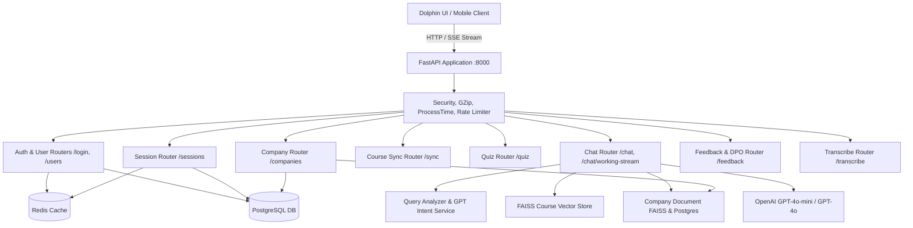

# 🐬 Dolphin Marine Tutor AI - Complete API Endpoint Architecture & Analysis

This document provides a comprehensive technical analysis of all **71 API endpoints** implemented in the Dolphin Marine Tutor AI backend. It details the purpose, HTTP methods, request payloads, response schemas, database/Redis interactions, and AI pipeline routing for every module.

---

## 🏛️ System Architecture Overview



---

## 📑 Module Index

| # | Module / Tag | Base Path | Endpoints | Core Functionality |
|---|---|---|---|---|
| 1 | **[Chat & Real-time AI](#1-chat--real-time-ai-module)** | `/chat` | 3 | Real-time SSE streaming, LLM response generation, SMS template extraction, topic clarification |
| 2 | **[Authentication & Access](#2-authentication--access-module)** | `/login`, `/logout` | 8 | CMS token validation, user creation, Redis profile caching, user course enrollment |
| 3 | **[Company Documents & SMS](#3-company-documents--sms-manuals-module)** | `/companies` | 1 | Upload company SMS manuals, word doc text extraction, FAISS vector indexing |
| 4 | **[Sessions & History](#4-sessions--conversation-history-module)** | `/sessions` | 10 | Session lifecycle, Redis message cache, persistent PostgreSQL history, bookmarking |
| 5 | **[Quiz & Assessment](#5-quiz--assessment-module)** | `/quiz` | 3 | MCQ generation from topic curriculum, answer submission, automated grading |
| 6 | **[Course Synchronizer](#6-course-synchronizer-module)** | `/sync` | 6 | CMS curriculum ingestion, master content sync, Excel course content sync |
| 7 | **[Feedback & DPO Dataset](#7-feedback--rlhf--dpo-module)** | `/feedback` | 21 | RLHF feedback collection, approval/rejection queues, DPO dataset generation for fine-tuning |
| 8 | **[Course Verification](#8-course-verification-module)** | `/course` | 1 | Validates if requested maritime topics match enrolled company/user courses |
| 9 | **[User Administration](#9-user-administration-module)** | `/users` | 2 | Administrative user listings, role updates, company permission assignments |
| 10 | **[Video Transcription](#10-video-transcription-module)** | `/transcribe` | 1 | Video transcription processing, timestamp alignment, vector chunking |
| 11 | **[General & Media Storage](#11-general--storage-module)** | `/storage`, `/images`, etc. | 15 | Static media streaming, machinery diagram delivery, PDF thumbnail generation, system health |

---

## 1. Chat & Real-time AI Module

Source File: `backend/api/chat_router.py`  
Pipeline Service: `backend/services/chat_service.py`

### Endpoints Overview

| Method | Path | Summary | Description |
|---|---|---|---|
| `POST` | `/chat` | Non-streaming Chat | Full single-request query processing returning a complete `NodeResponse` |
| `POST` | `/chat/working-stream` | Streaming Chat (SSE) | Production endpoint used by UI for real-time Server-Sent Events streaming |
| `POST` | `/chat/switch-session` | Switch Active Session | Sets active session ID in Redis for the user |

---

### Deep-Dive: `POST /chat/working-stream`
- **Purpose**: Primary conversational interface. Streams tokens in real-time, displays thinking stages, handles Safety Management System (SMS) permit discovery/generation, dispatches "Did you mean...?" topic clarifications, and enriches responses with machinery images and video clips.
- **Request Headers**: `Content-Type: application/json`, Cookie: `marine_user_id` (optional).
- **Request Body (`TestChatMessage`)**:
  ```json
  {
    "content": "give sms template",
    "session_id": "sess_12345",
    "user_id": "user_001",
    "role": "Chief Engineer",
    "ship": "M/T Dolphin Pride",
    "ship_type": "Oil Tanker",
    "company": "Sirius Shipping",
    "skip_clarification": false
  }
  ```
- **Internal Execution Flow**:
  1. **User Resolution**: Checks Redis (`user:{user_id}`) or PostgreSQL (`SELECT * FROM users WHERE id = $1`) to extract `company_id` and assigned vessel.
  2. **Fast-Path Intent Engine**:
     - Fast greetings, thanks, goodbyes, and well-wishes bypass LLM rewriting (0.00s latency).
     - Standalone verified marine technical terms bypass heavy intent routing.
  3. **SMS Permit & Template Detector**:
     - Scans for keywords matching `SPECIFIC_PERMIT_PATTERNS` (Hot Work SS 001, Cold Work SS 002, Enclosed Space SS 004, Bunkering Checklist E05) or general `DISCOVERY` (`"give sms template"`).
     - When detected, retrieves the official company document or manual extract and formats clean markdown checklists.
  4. **Parallel RAG Retrieval**:
     - Concurrently queries FAISS course index (`retrieval_node`) and company document store (`company_retrieval_node`).
  5. **SSE Stream Emission**:
     - Emits `status` events: `{"type": "status", "stage": "thinking" | "fetching" | "generating"}`.
     - Emits `content` tokens: `{"type": "content", "token": "..."}`.
     - Emits `media` events: Diagrams, machinery schematics, video timestamp deep-links.
     - Emits `suggestions`: Interactive follow-up question chips.
     - Emits `done`: Finalization and session save signal.

---

### Deep-Dive: `POST /chat`
- **Purpose**: RESTful batch chat endpoint. Executes the complete graph pipeline and returns structured JSON containing sections, source chunks, videos, images, and metadata.
- **Response Schema (`NodeResponse`)**:
  ```json
  {
    "type": "query",
    "content": "Markdown formatted answer...",
    "sections": [
      { "topic_code": "DGS-ENG-01", "topic_name": "Main Engine Scavenge Fire", "content": "..." }
    ],
    "chunks_used": [102, 105],
    "videos": [{ "title": "Scavenge Fire Procedure", "url": "/storage/videos/scavenge.mp4" }],
    "images": [{ "title": "Relief Valve Diagram", "url": "/dolphin/images/valve.jpg" }],
    "question_suggestions": ["What are the warning signs of a scavenge fire?", "Explain scavenge drain checks"],
    "metadata": { "category": "QUERY", "latencies": { "total": 1.25 } }
  }
  ```

---

### Deep-Dive: `POST /chat/switch-session`
- **Purpose**: Updates Redis active session pointer for a given user.
- **Payload**: `{"session_id": "sess_9999"}`.

---

## 2. Authentication & Access Module

Source File: `backend/api/login_router.py`  
Source File: `backend/api/logout_router.py`  
Source File: `backend/api/forgot_password.py`

### Endpoints Overview

| Method | Path | Summary | Description |
|---|---|---|---|
| `POST` | `/login` | Main User Login | Validates user against CMS remote API or local DB, creates session, caches Redis profile |
| `POST` | `/login/login1` | Login Alias | Alternate endpoint mapping for login integration |
| `POST` | `/login/test-login` | Testing Login | Bypasses external remote CMS authentication for local automated testing |
| `POST` | `/login/create` | Create User | Explicitly creates a user account with role, company, and ship attributes |
| `GET` | `/login/usercourses/{user_id}` | Get User Courses | Fetches list of registered courses for user |
| `POST` | `/login/usercourses/{user_id}` | Sync User Courses | Synchronizes user course assignments with CMS API |
| `GET` | `/login/debug-db` | Database Schema Debug | Returns column definitions of the `users` PostgreSQL table |
| `POST` | `/logout` | Logout | Invalidates active user session and clears cookies |
| `POST` | `/forgot-password` | Password Recovery | Initiates password reset flow |

---

### Key Workflow: `POST /login`
1. Accepts email/username, password, role, company name, ship name, ship type.
2. Checks CMS remote API (`COMPANY_COURSES_API_URL`) using security key.
3. Automatically creates or updates record in PostgreSQL `public.users`.
4. Saves user metadata into Redis with TTL:
   - Key: `user:{user_id}`
   - Contents: `id`, `name`, `email`, `role`, `company_name`, `company_id`, `ship_name`, `ship_type`, `user_courses`, `company_courses`.
5. Sets HTTP-only cookies: `marine_user_id`, `marine_session_id`, `access_token`.

---

## 3. Company Documents & SMS Manuals Module

Source File: `backend/api/company_router.py`  
Service: `backend/services/company_services.py`  
Extractor: `backend/services/document_extractor.py`

### Endpoints Overview

| Method | Path | Summary | Description |
|---|---|---|---|
| `POST` | `/companies/upload` | Upload Company Documents | Uploads SMS manuals, permit forms, checklists; parses text and indexes into FAISS |

---

### Deep-Dive: `POST /companies/upload`
- **Parameters**:
  - `company_id` (Form parameter): Unique ID representing the shipping company (e.g. `824866`).
  - `files` (Multipart form files): One or more `.docx`, `.pdf`, `.txt` files containing Shipboard SMS Manuals, Work Permits, or SOPs.
- **Internal Processing**:
  1. `extract_document_text`: Parses docx structure, extracts tables, form control fields, headers, and body paragraphs.
  2. Stores document metadata and full text in PostgreSQL table `public.company_documents` (`document_id`, `company_id`, `document_title`, `document_content`, `is_active`).
  3. Indexes document chunks into `CompanyDocumentStore` backed by `company_index.bin` FAISS vector store.
- **Response**: `CompanyDocumentUploadResponse` with list of stored document IDs and titles.

---

## 4. Sessions & Conversation History Module

Source File: `backend/api/session_router.py`

### Endpoints Overview

| Method | Path | Summary | Description |
|---|---|---|---|
| `GET` | `/sessions` | List User Sessions | Returns all chat sessions belonging to the authenticated user |
| `POST` | `/sessions` | Create New Session | Instantiates a new empty conversation session |
| `GET` | `/sessions/{session_id}` | Get Session Details | Loads message history, topic title, and creation timestamps |
| `DELETE` | `/sessions/{session_id}` | Delete Session | Deletes session from PostgreSQL and flushes Redis message cache |
| `POST` | `/sessions/save/{session_id}` | Bookmark/Save Session | Toggles `is_saved` boolean on a session for quick retrieval |
| `GET` | `/sessions/saved/{user_id}` | Get Saved Sessions | Fetches bookmarked sessions for user dashboard |
| `POST` | `/sessions/message-feedback` | Record Message Rating | Saves thumbs-up / thumbs-down rating directly on a conversation turn |
| `GET` | `/sessions/topic/{topic_code}` | Get Topic Content | Retrieves master curriculum text for a specific topic code |
| `GET` | `/sessions/get_all/sessions/` | Admin: List All Sessions | Paginated administrative view of all historical sessions across all users |
| `GET` | `/sessions/` | Filtered Sessions View | Administrative query endpoint with user ID, date range, and keyword filters |

---

## 5. Quiz & Assessment Module

Source File: `backend/api/quiz_router.py`  
Pipeline: `backend/pipeline/quiz.py`

### Endpoints Overview

| Method | Path | Summary | Description |
|---|---|---|---|
| `POST` | `/quiz/generate` | Generate Quiz Questions | Creates dynamic multiple-choice assessment based on recent conversation topic |
| `POST` | `/quiz/submit` | Submit Quiz Answers | Records user selections, computes score, and stores results |
| `POST` | `/quiz/grade` | Grade Quiz & Give Feedback | Evaluates answers, provides correct options, and returns pedagogical explanations |

---

### Deep-Dive: `POST /quiz/generate`
- **Request Body**:
  ```json
  {
    "topic_code": "MARPOL-VI",
    "topic_name": "Sulphur Emission Control Areas (SECA)",
    "num_questions": 5,
    "difficulty": "medium"
  }
  ```
- **Behavior**: Uses LLM with domain grounding from course chunks to generate realistic maritime scenario MCQs with 4 choices, question rationale, and correct option indicators.

---

## 6. Course Synchronizer Module

Source File: `backend/course_sync/course_sync_router.py`

### Endpoints Overview

| Method | Path | Summary | Description |
|---|---|---|---|
| `POST` | `/sync/courses` | Sync Courses | Syncs active courses and topics from central MarinerSkills CMS |
| `POST` | `/sync/masterData` | Sync Master Curriculum | Ingests all maritime competency frameworks and standards |
| `POST` | `/sync/masterContent` | Sync Master Content | Downloads lesson text, images, and video mappings |
| `POST` | `/sync/sync-course-content-excel` | Excel Course Ingestion | Uploads spreadsheet to bulk create or update course topics and media |
| `POST` | `/sync/retry` | Retry Sync | Retries failed course synchronization jobs |
| `POST` | `/sync/delete` | Delete Local Courses | Purges deleted courses from local tutor DB |

---

## 7. Feedback, RLHF & DPO Module

Source File: `backend/api/feedback_router.py`

This module provides human-in-the-loop review, dataset curation, and Direct Preference Optimization (DPO) preparation.

### Endpoints Overview

| Method | Path | Summary | Description |
|---|---|---|---|
| `POST` | `/feedback` | Submit Feedback | Logs user feedback, thumbs rating, and correction notes on a bot response |
| `GET` | `/feedback/pending` | List Pending Feedback | Moderator queue of unreviewed AI responses needing verification |
| `GET` | `/feedback/approved` | List Approved QA Pairs | Curated high-quality responses approved for memory and fine-tuning |
| `GET` | `/feedback/dashboard` | Feedback Dashboard | Complete summary stats (total, pending, approved, rejected, avg rating) |
| `GET` | `/feedback/stats/counts` | Feedback Counts | Breakdown of feedback counts grouped by category |
| `GET` | `/feedback/topics/search` | Topic Autocomplete | Searches topics linked to feedback entries |
| `GET` | `/feedback/{feedback_id}` | Get Feedback by ID | Retrieves specific feedback item with original query and model response |
| `POST` | `/feedback/{feedback_id}/approve` | Approve Response | Approves model answer; adds to high-confidence approved memory |
| `POST` | `/feedback/{feedback_id}/reject` | Reject Response | Rejects response and marks reason (factual error, off-topic, hallucination) |
| `PUT` | `/feedback/{feedback_id}/approved` | Edit Approved Response | Allows subject matter experts (SME) to edit and refine the approved response |
| `DELETE` | `/feedback/{feedback_id}/approved` | Unapprove Response | Removes response from approved memory |
| `POST` | `/feedback/{feedback_id}/regenerate` | Regenerate Answer | Re-queries the LLM with higher guidance to produce an alternate answer |
| `PATCH` | `/feedback/{feedback_id}/review` | Update Review Status | Updates review notes and auditor metadata |
| `DELETE` | `/feedback/{feedback_id}` | Delete Feedback | Deletes feedback record |
| `DELETE` | `/feedback/session/{session_id}/message/{message_id}` | Delete Message Feedback | Purges feedback linked to specific session message |
| `GET` | `/feedback/dpo/dataset` | Export DPO Dataset | Exports JSONL dataset with `prompt`, `chosen`, and `rejected` completions |
| `POST` | `/feedback/dpo/jobs` | Trigger DPO Job | Starts a background fine-tuning or export preparation job |
| `GET` | `/feedback/dpo/jobs` | List DPO Jobs | Checks status and progress of running DPO export jobs |

---

## 8. Course Verification Module

Source File: `backend/api/course_router.py`

### Endpoints Overview

| Method | Path | Summary | Description |
|---|---|---|---|
| `POST` | `/course/check-topic-course` | Check Topic Course Membership | Verifies if a queried topic belongs to any course registered by the user's company |

- **Usage**: Used by frontend and chat routing to ensure users only access material covered under their subscribed curriculum packages.

---

## 9. User Administration Module

Source File: `backend/api/user_router.py`

### Endpoints Overview

| Method | Path | Summary | Description |
|---|---|---|---|
| `GET` | `/users` | List Users | Returns paginated list of all registered users with role and company |
| `PUT` | `/users/{user_id}/role` | Update User Role | Assigns or modifies permissions (e.g. `student`, `instructor`, `admin`) |

---

## 10. Video Transcription Module

Source File: `backend/api/video_transcribe_router.py`

### Endpoints Overview

| Method | Path | Summary | Description |
|---|---|---|---|
| `POST` | `/transcribe/video` | Transcribe Video | Ingests audio from instructional videos, generates timestamped transcripts, and indexes segments into `transcribe_index.bin` |

---

## 11. General & Storage Module

Source File: `backend/main.py`

### Endpoints Overview

| Method | Path | Summary | Description |
|---|---|---|---|
| `GET` | `/api/v1/health` | System Health Check | Returns database status, Redis status, and service uptime |
| `GET` | `/api/v1/faiss/status` | FAISS Index Health | Returns total indexed vectors, chunk counts, and memory footprint |
| `GET` | `/storage/{filepath}` | Serve Storage File | Streams static machinery images, diagrams, and video assets |
| `GET` | `/dolphin/images/{filepath}` | Media Alias | Canonical CDN alias for maritime equipment photographs |
| `GET` | `/pdf_images/{filepath}` | PDF Diagram Extract | Delivers figures extracted from course PDF documents |
| `GET` | `/dolphin/pdf_thumbnail` | PDF Thumbnail | Delivers thumbnail previews for training manual documents |

---

## 🛡️ Security, Error Handling & Status Codes

All endpoints adhere to standardized HTTP status responses:

| Status Code | Condition |
|---|---|
| **`200 OK`** | Request succeeded. |
| **`400 Bad Request`** | Missing required parameters (e.g. empty message `content`, missing file). |
| **`401 Unauthorized`** | Missing or expired authentication token / cookie. |
| **`403 Forbidden`** | Insufficient permissions (e.g. non-admin attempting `/users/{id}/role`). |
| **`404 Not Found`** | Requested session, document, or feedback ID does not exist. |
| **`429 Too Many Requests`** | SlowAPI rate limiter triggered (exceeded allowable requests per minute). |
| **`500 Internal Server Error`** | Unhandled exception (logs detailed trace to Loguru). |

---

> [!NOTE]
> All chat endpoints (`/chat` and `/chat/working-stream`) run with real-time rate limiting managed by SlowAPI and Redis session caching to ensure low latency and high availability.
